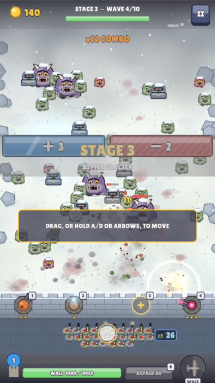
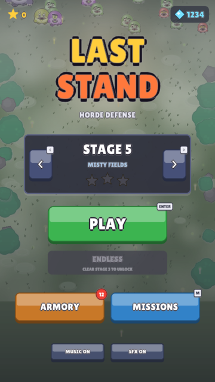
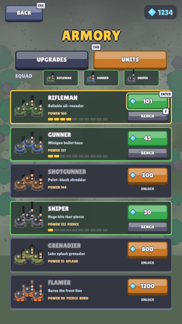
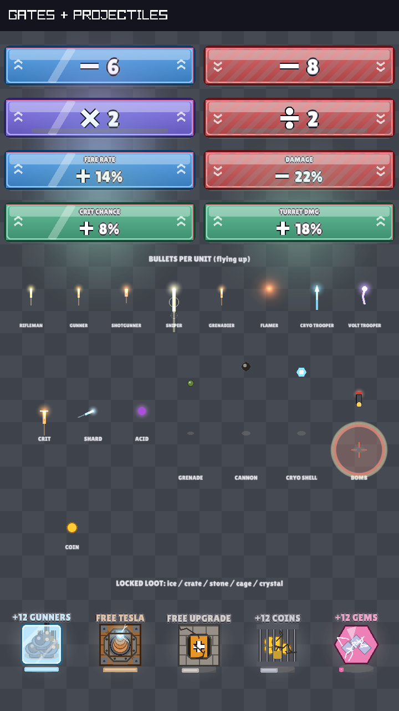

# Last Stand

A horde defense game: hold the wall while hundreds of monsters pour down the screen, grow your squad
through math gates, break open locked loot, stack upgrade cards into absurd builds and bring down
procedurally generated bosses.

It is the game those mobile ads promise, built in C++23 on raylib, playable on desktop and in the
browser (mouse, touch or keyboard).

[**Play in the browser**](https://salamaashoush.github.io/last-stand/)

<p>
  
  
  
</p>

## How it plays

- **Hold the wall.** Your squad stands behind it and fires at everything that comes. Drag (or hold
  A/D, arrow keys) to move along the wall; soldiers lean their aim toward the closest threat.
- **Gates are a choice, not a freebie.** Every gate row spans the whole field, so you pass through one
  of them. Rows usually hide a trap (`-12`, `÷2`) and a lane worth shooting: every bullet you put
  into a gate raises its number, every bullet you put into a gate is one not spent on the horde.
- **Locked loot.** Rewards drift down sealed in the stage's material: ice, wooden crates, stone,
  iron cages or magma crystal. Break them open for a squad of new units, a free turret, a free card,
  coins or gems, or let them hit the wall and lose them.
- **Level up mid-run.** Kills give XP; each level offers three cards (multishot, ricochet, incendiary,
  chain lightning, airstrikes, call in a new unit type and more). Pairs of cards evolve into
  Bullet Storm, Inferno, Thunder God and Shatter.
- **Frenzy.** Kills charge a meter; unleash it for six seconds of double fire rate.
- **Barrels and bats.** Explosive barrels drift with the horde and wipe out everything near them
  when shot; bat swarms weave fast over the field.
- **Stat gates.** Some lanes are FIRE RATE or DAMAGE gates that follow the same blue and red rule.
- **Build the wall up.** Four turret slots take cannons, tesla coils, flamers and railbeams, each
  upgradable five times. Coins also repair the wall.
- **Six units.** Rifleman, Gunner, Shotgunner, Sniper, Grenadier and Flamer, each with its own gun and
  look. Unlock and level them in the Armory and field up to three per squad.
- **A horde that adapts.** A director watches the wall. Flawless waves raise the threat level, near
  collapses ease it off, and enemy health tracks how far ahead of the curve your firepower is, so a
  run stays tense whether you are winning or losing.
- **Every stage is different.** A seed per stage picks its battleground (grassland, desert, frost,
  ashland), palette, weather, time of day, set dressing, loot material, enemy outfits and a boss
  grown from a genome: silhouette, horns, eyes, armour and two or three powers such as summoner,
  charger, shield, splitter, acid barrage, healer and enrage.
- **Wave mutators.** Fast hordes, ironclad armour, swarms, elite guards and giants keep waves from
  repeating.

Between runs, gems buy permanent upgrades and units. Stars per stage, tiered missions, a daily
supply drop with a streak, and an endless mode after stage 3 give the long game.

<p>
  
  
  
  
</p>

## Controls

Everything works with the mouse or touch. Keyboard shortcuts are listed below.

- **Move squad:** A / D or Left / Right.
- **Airstrike:** Space.
- **Frenzy** (when the meter is full): E.
- **Turret slots:** 1 to 4, then Up / Down and Enter to build, S to sell, Esc to close.
- **Repair wall:** R.
- **Upgrade cards:** 1 / 2 / 3, or Left / Right and Enter.
- **Pause:** Esc or P.
- **Menus:** Enter plays or confirms, Left / Right picks a stage, A opens the Armory, M the missions,
  Tab switches Armory tabs, Up / Down and Enter buy, F fields or benches a unit.

## Building

Needs a C++23 compiler (Clang 17+, GCC 13+) and CMake 3.25+. raylib, nlohmann/json and Catch2 are
fetched by CPM. On Linux, raylib also needs `libgl-dev libx11-dev libxrandr-dev libxinerama-dev
libxcursor-dev libxi-dev`.

```bash
make run        # debug build and run
make release    # optimized build
make test       # unit tests
make web        # browser build (needs emsdk; set EMSDK if it is not in ~/emsdk)
make web-serve  # serve build-web on http://localhost:8080
```

## Development tools

Three switches in the binary make the game testable without playing it by hand:

- `LS_HEADLESS=<runs>` simulates whole runs with no window at roughly 300x real time, an autopilot
  playing and spending gems between runs. `LS_STAGE` picks the starting stage, `LS_REPEAT=1` replays
  the same stage with a fresh account, and every wave and result is logged. This is how the
  difficulty curve is tuned.
- `LS_AUTOPILOT=1` lets the autopilot play the windowed game; add `LS_SHOT_DIR=<dir>` and
  `LS_SHOT_EVERY=<seconds>` to capture screenshots, `LS_SPEED=<n>` to fast-forward.
- `LS_GALLERY=<dir>` renders every enemy, unit, turret, gate, projectile, effect timelapse, card,
  theme, boss and screen into labelled PNGs with collision radii and muzzle points overlaid, for
  reviewing art one asset at a time.

## Project layout

```
src/
  core/        window, input, drawing helpers, state machine
  game/        simulation, rendering, HUD, balance, cards, gates, units, turrets,
               themes and bosses, meta progression, saves, autopilot, gallery
  managers/    asset loading, synthesized sound effects, save storage
  states/      menu, battle, results, armory, missions
tests/         unit tests for the pure game logic
web/           browser page
```

Sound effects are synthesized at startup; the only audio files are the music tracks. Saves go to
`laststand_save.json` on desktop and to `localStorage` in the browser.

## Credits

- [Kenney](https://kenney.nl) Tower Defense (top-down) and Particle packs, CC0
- [Ninja Adventure](https://pixel-boy.itch.io/ninja-adventure-asset-pack) by Pixel-boy and AAA, CC0,
  for the music
- [Lilita One](https://fonts.google.com/specimen/Lilita+One) by Juan Montoreano, SIL Open Font License
  (`assets/fonts/LilitaOne-OFL.txt`)
