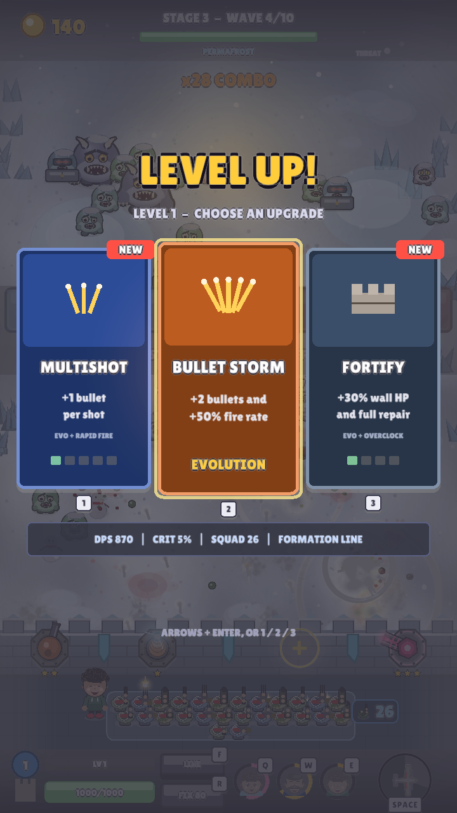
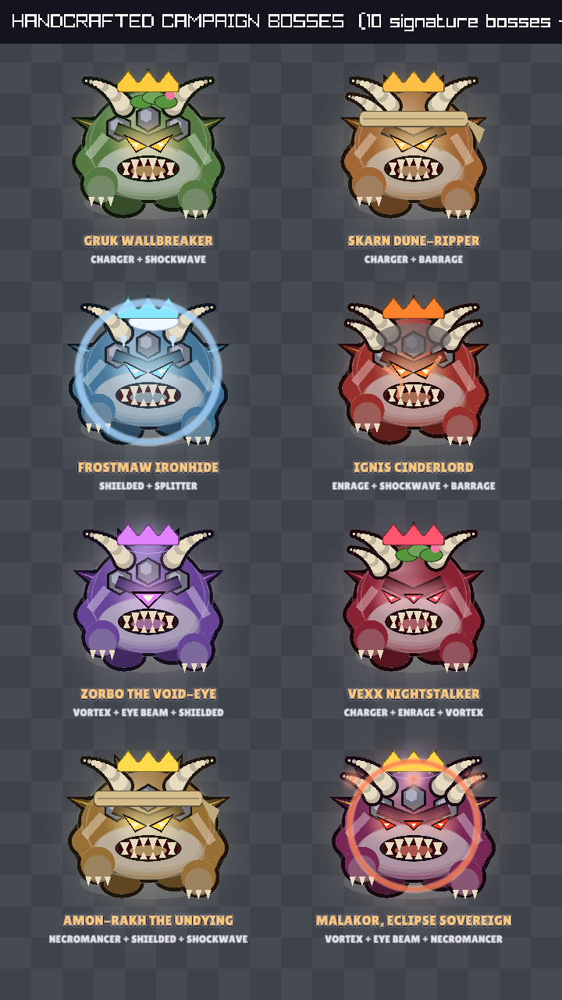
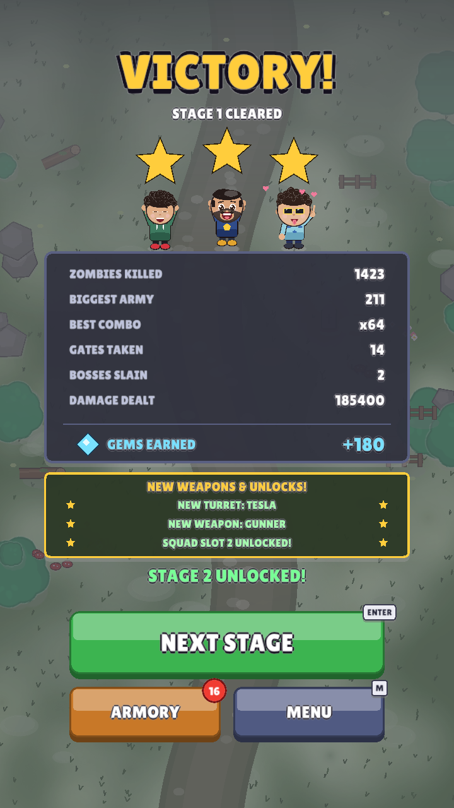
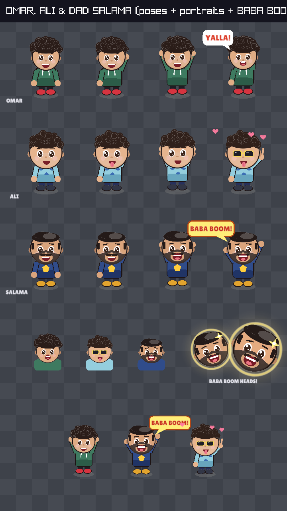
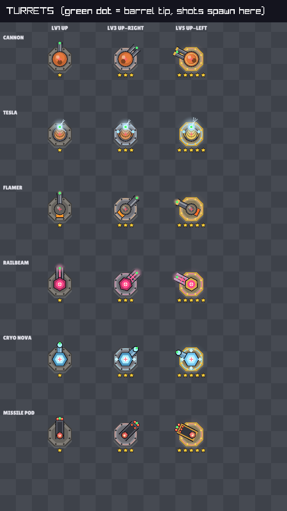
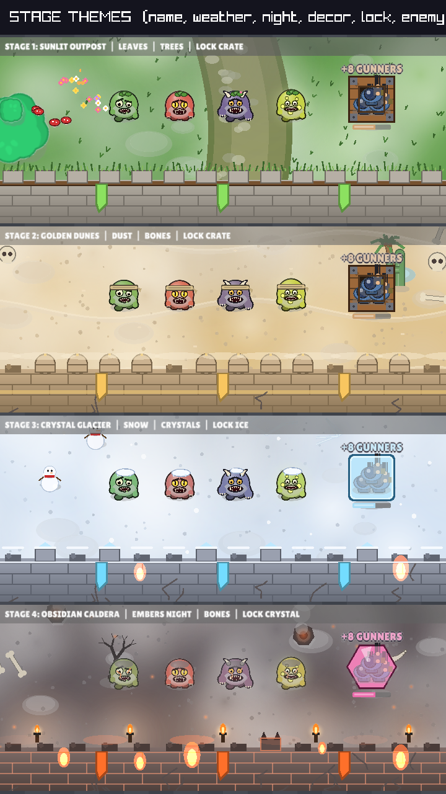
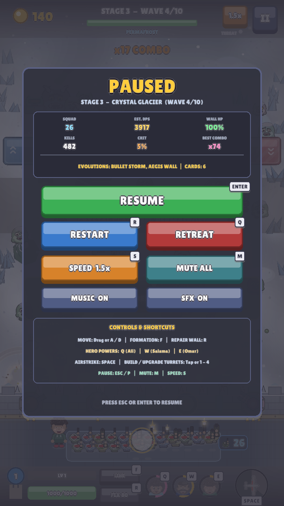

# Last Stand

A portrait horde-defense arcade game: hold the fortress wall while hundreds of monsters pour down the
screen, grow your squad through tactical math & stat gates, break open locked loot, evolve upgrade
cards into absurd builds, deploy 6 evolving wall turrets, unleash family hero powers (**Omar, Ali &
Dad Salama**), and conquer a **10-stage handcrafted campaign** plus infinite **Endless Mode**.

Built in C++23 on raylib 6.2, playable on desktop and heavily optimized for mobile browsers (touch,
mouse, or keyboard).

[**Play in the browser**](https://salamaashoush.github.io/last-stand/)

<p>
  
  
  
</p>

## How it plays

- **Hold the fortified wall.** Your squad defends behind biome-styled battlements that visually
  upgrade with steel/gilded armor bands and active **thorns spikes** as you invest in wall defense.
  Drag (or hold `A`/`D`, arrow keys) to move along the wall, and press `F` to switch between
  **Line** (balanced), **Wedge** (`+20%` damage / `+10%` crit), and **Guard** (`-20%` wall damage)
  formations.
- **Gates are a choice, not a freebie.** Every gate row spans the whole field, so you pass through
  one lane. Shoot blue gates (`+`, `×`, `FIRE RATE`, `DAMAGE`, `CRIT CHANCE`, `TURRET DMG`) to boost
  their values while dodging red traps (`-`, `÷`).
- **Locked loot.** Rewards drift down sealed in the stage's material (ice, wooden crates, stone,
  iron cages, or magma crystal). Shatter them for extra soldiers, a free turret, a free card, coins,
  or gems before they crash into your wall.
- **28 upgrade cards & 7 evolutions.** Level up mid-run to stack weapons, elemental effects, turret
  overclock, field engineers, and hero charge — and pair cards to unlock 7 evolutions (**Bullet
  Storm**, **Inferno**, **Thunder God**, **Shatter**, **Orbital Fury**, **Aegis Wall**, and
  **Phantom Split**).
- **Family hero powers (Omar, Ali & Salama) + V-Formation Airstrike.**
  - **Ali (`Q`)**: Strikes a sunglasses peace sign, charming monsters with floating hearts, healing
    the wall, and bursting bonus coins.
  - **Salama (`W` — *"Baba Boom!"*)**: Dad hurls giant spinning, laughing Salama heads that lock
    onto bosses and clusters, bounce once (`BOING!`), and detonate into coin & confetti mega-blasts!
  - **Omar (`E` — *"Yalla!"*)**: Rallies the squad for `2×` fire rate, `+30%` damage, `+20%` crit,
    and blasts back monsters crowding the wall.
  - **Airstrike (`Space`)**: Calls in a 3-jet swept-wing fighter squadron with forward autocannon
    strafing and finned carpet-bombing (upgraded to Napalm firestorms with *Orbital Fury*).
- **6 evolving turrets (Lv1 → Lv3 → Lv5).** Four wall slots take **Cannon**, **Flamer**, **Tesla**,
  **Cryo Nova**, **Railbeam**, and **Missile Pod** (homing rocket swarms). Every turret evolves
  visually and gains unique **Lv3** and **Lv5** apex perks (twin siege shells, storm novas, napalm
  pools, hyper-crit beams, ice shards, and 6-rocket cluster barrages).
- **8 soldier classes & squad synergies.** **Rifleman, Gunner, Shotgunner, Sniper, Grenadier,
  Flamer, Cryo Trooper, and Volt Trooper**, each with unique projectiles, passives, and Armory
  levels (up to Lv10). Field up to 4 classes in your Active Squad to trigger **Combined Arms**,
  **Bullet Hose**, **Ordnance**, and **Elemental** synergies.
- **Progressive unlocks every stage.** Clearing each stage automatically unlocks new turrets, free
  soldier weapons (auto-deployed into open squad slots), squad slots, or free upgrades — celebrated
  on the Victory screen and previewed on each stage card.
- **10 handcrafted stages + Endless Mode.** Every campaign stage features its own visual theme,
  biome hazard, paced enemy introductions (14 enemy types total including *Healers*, *Burrowers*,
  *Berserkers*, and *Warlords*), and a **handcrafted signature Boss + Mini-Boss** culminating in
  **Stage 10: Eclipse Throne (*Malakor, Eclipse Sovereign*)**.
- **Escalating Endless Mode.** Unlocked after Stage 3: shifts realms and twists every 5 waves,
  awards Wall repairs, Gems, and free upgrade cards on 5/10-wave milestones, spawns **Double
  Bosses** from Wave 20+, and tracks live personal-best records.
- **Tactical Pause Menu.** Includes one-tap **Mute All (`M`)**, separate Music/SFX toggles,
  **Game Speed (`1x / 1.5x / 2x`)**, live run stats & evolutions overview, and a full controls
  reference.

<p>
  
  
  
  
</p>

<p>
  
  
  
  
</p>

## Controls

Everything works with touch, mouse, or keyboard:

- **Move squad:** Drag, `A` / `D`, or Left / Right.
- **Change formation:** `F` (Line / Wedge / Guard).
- **Hero powers:** `Q` (Ali), `W` (Salama *Baba Boom*), `E` (Omar *Yalla* Rally).
- **Airstrike:** `Space`.
- **Turret slots:** Tap a wall slot or press `1`–`4`, then Up / Down and `Enter` to build/upgrade,
  `S` to sell, `Esc` to close.
- **Repair wall:** `R`.
- **Game speed:** Tap the `1x` button (top-right) or press `S` while paused (`1x` / `1.5x` / `2x`).
- **Upgrade cards:** `1` / `2` / `3`, or Left / Right and `Enter` (`R` to reroll).
- **Pause & Mute:** `Esc` or `P` to pause; `M` in the pause menu to mute/unmute all audio.
- **Menus:** `Enter` confirms, Left / Right picks a stage, `A` opens the Armory, `M` opens Missions,
  `Tab` switches Armory tabs, `F` deploys or benches a unit.

## Building

Needs a C++23 compiler (Clang 17+, GCC 13+) and CMake 3.25+. raylib, nlohmann/json and Catch2 are
fetched by CPM. On Linux, raylib also needs `libgl-dev libx11-dev libxrandr-dev libxinerama-dev
libxcursor-dev libxi-dev`.

```bash
make run        # debug build and run
make release    # optimized build
make test       # unit tests (31 Catch2 suites)
make web        # browser build (needs emsdk; set EMSDK if it is not in ~/emsdk)
make web-serve  # serve build-web on http://localhost:8080
```

## Development tools

Four built-in modes make balancing, visual QA, and regression testing fast without playing by hand:

- `LS_PROBE=1`: Runs deterministic combat experiments verifying all 28 cards, 7 evolutions, multi-level
  scaling, all 8 Armory upgrades, family hero powers, formations, all 8 units (Lv1 vs Lv6), and all
  6 turrets (Lv1 → Lv3 → Lv5).
- `LS_HEADLESS=<runs>`: Simulates full runs headlessly with the autopilot playing and spending gems
  between stages (`LS_STAGE` picks starting stage, `LS_REPEAT=1` replays fresh).
- `LS_AUTOPILOT=1`: Runs the autopilot in a live window; combine with `LS_SHOT_DIR=<dir>`,
  `LS_SHOT_EVERY=<seconds>`, and `LS_SPEED=<n>` to capture live gameplay screenshots.
- `LS_GALLERY=<dir>`: Renders all 23 visual QA sheets (enemies, units, turrets, projectiles,
  explosion timelapses, cards, stage themes, biome walls, bosses, heroes, and UI screens) into PNGs.

## Project layout

```
src/
  core/        window, input, procedural atlas & drawing helpers, state machine
  game/        simulation, rendering, HUD, balance, cards, gates, units, turrets,
               kids/heroes, themes & bosses, meta progression, saves, autopilot, probe, gallery
  managers/    asset loading, synthesized sound effects, save storage
  states/      menu, battle, results, armory, missions
tests/         Catch2 unit tests for pure game logic, unlocks, gates, cards & saves
web/           browser shell, manifest, and mobile PWA icons
```

Sound effects are synthesized at startup; the only audio files are the music tracks. Saves go to
`laststand_save.json` on desktop and to `localStorage` in the browser.

## Credits

- [Kenney](https://kenney.nl) Tower Defense (top-down) and Particle packs, CC0
- [Ninja Adventure](https://pixel-boy.itch.io/ninja-adventure-asset-pack) by Pixel-boy and AAA, CC0,
  for the music
- [Lilita One](https://fonts.google.com/specimen/Lilita+One) by Juan Montoreano, SIL Open Font License
  (`assets/fonts/LilitaOne-OFL.txt`)
